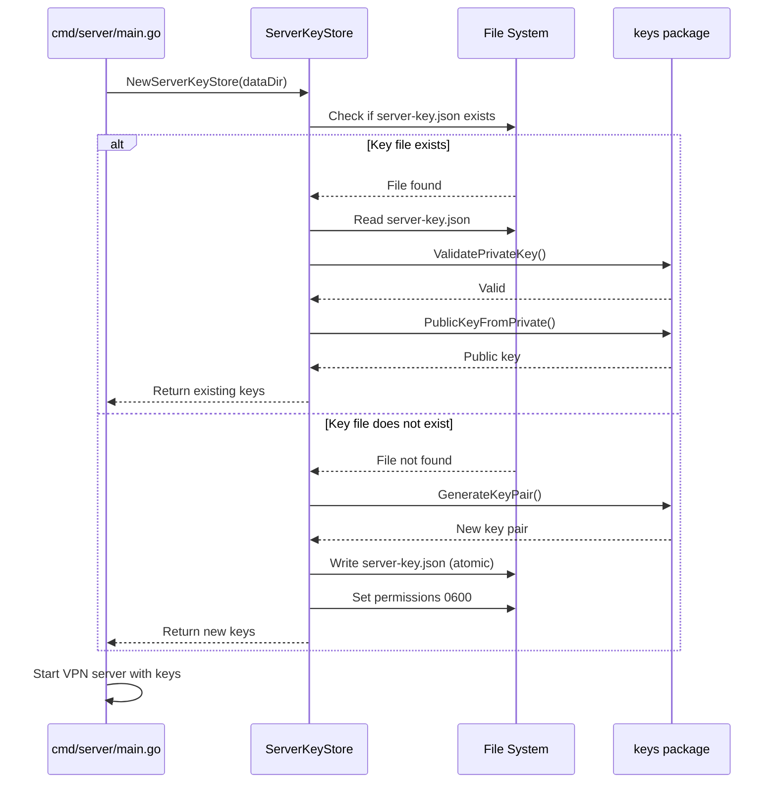

# Design Document: Persistent Server Keys

## Overview

This design implements persistent storage for the VPN server's WireGuard key pair, ensuring the server maintains the same cryptographic identity across restarts and redeployments. The implementation follows the existing persistence pattern used for peer storage (`PeerStore`) and integrates seamlessly with the current server initialization flow.

**Key Benefits:**
- Clients register once and connect reliably across server restarts
- Eliminates forced re-registration after server redeployment
- Maintains WireGuard best practices for key management
- Follows existing codebase patterns for consistency

## Architecture

### Component Overview

```
cmd/server/main.go
    ↓ (uses)
internal/server/keystore/
    ├── keystore.go          (new: ServerKeyStore)
    └── keystore_test.go     (new: unit tests)
    ↓ (uses)
internal/wireguard/keys/
    └── keys.go              (existing: key generation/validation)
```

### Data Flow



## Components and Interfaces

### 1. ServerKeyStore (New Component)

**Location:** `internal/server/keystore/keystore.go`

**Purpose:** Manages persistent storage and retrieval of server WireGuard keys

**Interface:**
```go
package keystore

import (
    "encoding/json"
    "fmt"
    "os"
    "path/filepath"
    "sync"
    "time"
    
    "github.com/november1306/go-vpn/internal/wireguard/keys"
)

// ServerKeys represents the server's WireGuard key pair
type ServerKeys struct {
    PrivateKey  string    `json:"privateKey"`
    PublicKey   string    `json:"publicKey"`
    GeneratedAt time.Time `json:"generatedAt"`
}

// ServerKeyStore manages persistent storage of server WireGuard keys
type ServerKeyStore struct {
    mu       sync.RWMutex
    keys     *ServerKeys
    filePath string
}

// NewServerKeyStore creates or loads server keys from persistent storage
// If keys don't exist, generates new ones and saves them
func NewServerKeyStore(dataDir string) (*ServerKeyStore, error)

// GetKeys returns the server's key pair (thread-safe)
func (ks *ServerKeyStore) GetKeys() ServerKeys

// GetPrivateKey returns just the private key (convenience method)
func (ks *ServerKeyStore) GetPrivateKey() string

// GetPublicKey returns just the public key (convenience method)
func (ks *ServerKeyStore) GetPublicKey() string

// RegenerateKeys generates new keys and saves them (for key rotation)
func (ks *ServerKeyStore) RegenerateKeys() error

// Private methods
func (ks *ServerKeyStore) load() error
func (ks *ServerKeyStore) save() error
func (ks *ServerKeyStore) generateAndSave() error
```

### 2. Integration with Server Main

**Location:** `cmd/server/main.go`

**Changes Required:**
```go
// Before (current):
serverPrivateKey, serverPublicKey, err := keys.GenerateKeyPair()
if err != nil {
    log.Fatalf("Failed to generate server keys: %v", err)
}

// After (with persistence):
keyStore, err := keystore.NewServerKeyStore(dataDir)
if err != nil {
    log.Fatalf("Failed to initialize server keys: %v", err)
}

serverPrivateKey := keyStore.GetPrivateKey()
serverPublicKey := keyStore.GetPublicKey()
```

## Data Models

### Server Key Storage Format

**File:** `data/server-key.json`

**Structure:**
```json
{
  "privateKey": "YJwvHfX4Km9f8d3wq5N8F2g5z7m1P3Q6r9s2B5x8C4A=",
  "publicKey": "m8wHgY5Lm0g9e4xr6O9G3h6z8n2Q4R7t0u3C6y9D5B=",
  "generatedAt": "2025-01-10T15:30:00Z"
}
```

**File Permissions:**
- Unix/Linux/macOS: `0600` (owner read/write only)
- Windows: Uses default file permissions (NTFS ACLs)

**Storage Location:**
- Same `data/` directory used for `peers.json`
- Ensures all persistent state is in one location
- Easy to backup/restore entire server state

## Error Handling

### Error Scenarios and Responses

| Scenario | Detection | Response | User Impact |
|----------|-----------|----------|-------------|
| Data directory doesn't exist | `os.Stat()` returns `IsNotExist` | Create directory with `0700` permissions | Transparent - auto-created |
| Key file doesn't exist | `os.Stat()` returns `IsNotExist` | Generate new keys and save | First-time setup |
| Key file corrupted/invalid JSON | `json.Unmarshal()` fails | Log error, fail server startup | Admin must fix or delete file |
| Invalid private key format | `keys.ValidatePrivateKey()` fails | Log error, fail server startup | Admin must fix or delete file |
| Cannot write key file | `os.WriteFile()` fails | Log error, fail server startup | Admin must fix permissions |
| Insecure file permissions | `os.Stat()` shows wrong perms | Log warning, continue | Security warning logged |

### Error Messages

```go
// Clear, actionable error messages
"failed to create data directory: %w"
"failed to load server keys: %w - delete data/server-key.json to regenerate"
"invalid server private key in storage: %w - delete data/server-key.json to regenerate"
"failed to save server keys: %w - check directory permissions"
```

## Testing Strategy

### Unit Tests

**File:** `internal/server/keystore/keystore_test.go`

**Test Cases:**
1. `TestNewServerKeyStore_GeneratesNewKeys` - First-time initialization
2. `TestNewServerKeyStore_LoadsExistingKeys` - Loads from existing file
3. `TestNewServerKeyStore_InvalidJSON` - Handles corrupted file
4. `TestNewServerKeyStore_InvalidPrivateKey` - Validates key format
5. `TestNewServerKeyStore_CreatesDataDirectory` - Auto-creates directory
6. `TestServerKeyStore_GetKeys` - Thread-safe key retrieval
7. `TestServerKeyStore_RegenerateKeys` - Key rotation functionality
8. `TestServerKeyStore_AtomicWrite` - Atomic file operations
9. `TestServerKeyStore_FilePermissions` - Secure permissions (Unix only)
10. `TestServerKeyStore_ConcurrentAccess` - Thread safety

### Integration Tests

**Manual Testing Scenarios:**
1. **Fresh Deployment:**
   - Deploy server to new environment
   - Verify keys are generated and saved
   - Verify `data/server-key.json` exists with correct permissions
   - Verify server public key is logged

2. **Server Restart:**
   - Start server, note public key
   - Stop server
   - Start server again
   - Verify same public key is used
   - Verify "Loaded existing server key" log message

3. **Client Connection Continuity:**
   - Client registers with server
   - Server restarts
   - Client connects without re-registration
   - Verify tunnel establishes successfully

4. **Key File Corruption:**
   - Corrupt `data/server-key.json`
   - Start server
   - Verify clear error message
   - Delete file, restart
   - Verify new keys generated

5. **Upgrade from Non-Persistent Version:**
   - Deploy old version (no key persistence)
   - Register clients
   - Upgrade to new version
   - Verify keys are generated and saved on first startup
   - Note: Existing clients will need to re-register once

## Security Considerations

### File Permissions

**Unix/Linux/macOS:**
```go
// Set restrictive permissions on key file
os.WriteFile(tempPath, data, 0600) // Owner read/write only
```

**Windows:**
- Uses default NTFS permissions
- Inherits from parent directory
- Admin should configure NTFS ACLs if needed

### Atomic Writes

```go
// Write to temp file first, then atomic rename
tempPath := ks.filePath + ".tmp"
os.WriteFile(tempPath, data, 0600)
os.Rename(tempPath, ks.filePath) // Atomic on Unix
```

**Benefits:**
- Prevents corruption if write fails mid-operation
- Ensures file is always in valid state
- Follows same pattern as `PeerStore`

### Key Validation

```go
// Always validate keys loaded from disk
if err := keys.ValidatePrivateKey(serverKeys.PrivateKey); err != nil {
    return nil, fmt.Errorf("invalid server private key in storage: %w", err)
}
```

**Benefits:**
- Detects corrupted or tampered keys
- Fails fast with clear error message
- Prevents server from starting with invalid keys

### Backup and Recovery

**Backup Strategy:**
- Include `data/server-key.json` in server backups
- Backup entire `data/` directory for complete state
- Store backups securely (encrypted at rest)

**Recovery Strategy:**
- Restore `data/` directory from backup
- Server will load existing keys on startup
- All registered clients remain valid

**Key Rotation (Future Enhancement):**
```go
// Manual key rotation if needed
keyStore.RegenerateKeys()
// Note: All clients must re-register after key rotation
```

## Implementation Plan Integration

This design integrates with the existing codebase:

1. **Follows Existing Patterns:**
   - Mirrors `PeerStore` structure and patterns
   - Uses same `data/` directory
   - Same atomic write approach
   - Same error handling style

2. **Minimal Changes:**
   - New package: `internal/server/keystore/`
   - Modified file: `cmd/server/main.go` (10 lines changed)
   - No changes to client code
   - No changes to API contracts

3. **Backward Compatibility:**
   - First startup with new version generates keys
   - Existing deployments work without manual intervention
   - Old clients need to re-register once (acceptable for upgrade)

4. **Future Enhancements:**
   - Key rotation API endpoint
   - Key expiration/renewal
   - Multiple key support (key versioning)
   - HSM integration for enterprise deployments

## Logging Strategy

### Startup Logs

```go
// First-time key generation
slog.Info("Generated new server key pair", "publicKey", publicKey)

// Loading existing keys
slog.Info("Loaded existing server key", "publicKey", publicKey, "generatedAt", keys.GeneratedAt)

// Key file permissions warning (Unix only)
slog.Warn("Server key file has insecure permissions", "path", filePath, "permissions", fileInfo.Mode())
```

### Error Logs

```go
// Failed to load keys
slog.Error("Failed to load server keys", "error", err, "path", filePath)

// Invalid key format
slog.Error("Invalid server private key in storage", "error", err)

// Failed to save keys
slog.Error("Failed to save server keys", "error", err, "path", filePath)
```

### Debug Logs

```go
// Key store initialization
slog.Debug("Initializing server key store", "dataDir", dataDir)

// File operations
slog.Debug("Server key file exists, loading", "path", filePath)
slog.Debug("Server key file not found, generating new keys")
```

## Performance Considerations

### Startup Performance

- **Key Loading:** Single file read operation (~1ms)
- **Key Generation:** Curve25519 operation (~1-5ms)
- **File Write:** Single atomic write (~1-2ms)
- **Total Impact:** Negligible (<10ms added to startup)

### Runtime Performance

- **No Runtime Impact:** Keys loaded once at startup
- **Thread-Safe Access:** RWMutex for concurrent reads
- **Memory Footprint:** ~200 bytes for key storage

### Scalability

- **Single Server:** No scalability concerns
- **Multi-Server (Future):** Each server has unique keys
- **Load Balancer (Future):** Requires shared key storage or key distribution

## Deployment Considerations

### DigitalOcean Deployment

**Current Setup:**
- Server runs on DigitalOcean droplet
- Data directory: `/root/go-vpn/data/`
- Automatic key generation on first startup

**Upgrade Process:**
1. Deploy new server binary
2. Restart server
3. Keys generated automatically
4. Existing clients re-register once
5. Future restarts preserve keys

### Docker Deployment

**Volume Mounting:**
```yaml
volumes:
  - ./data:/app/data  # Persist keys and peer data
```

**Benefits:**
- Keys persist across container restarts
- Easy backup (backup `./data` directory)
- Portable across environments

### Multi-Environment Strategy

**Development:**
- Keys regenerate per environment
- Each dev has unique server keys
- No key sharing between environments

**Production:**
- Keys persist in production data directory
- Include in backup strategy
- Document key recovery procedures

## Migration Path

### Upgrading from Current Version

**Step 1: Deploy New Version**
- New binary includes key persistence
- No configuration changes needed

**Step 2: First Startup**
- Server generates and saves keys
- Logs: "Generated new server key pair"
- `data/server-key.json` created

**Step 3: Client Re-Registration**
- Existing clients must re-register (one-time)
- Clients run: `vpn-cli register --server=<url>`
- New configuration stored locally

**Step 4: Normal Operation**
- Future server restarts preserve keys
- Clients connect without re-registration
- Improved user experience

### Rollback Strategy

If issues arise:
1. Stop new server version
2. Deploy old server version
3. Delete `data/server-key.json`
4. Start old server version
5. Clients re-register with old server

## Documentation Updates

### Admin Documentation

**Topics to Document:**
- Key persistence behavior
- Backup and recovery procedures
- Key rotation process (future)
- Troubleshooting key issues
- Security best practices

### User Documentation

**Topics to Document:**
- One-time registration process
- What happens during server upgrades
- When re-registration is required
- Troubleshooting connection issues

## Success Metrics

### Functional Metrics

- ✅ Server maintains same public key across restarts
- ✅ Clients connect without re-registration after server restart
- ✅ Key file created with secure permissions
- ✅ Clear logging for key operations

### Operational Metrics

- ✅ Zero downtime for key loading
- ✅ Atomic file operations prevent corruption
- ✅ Clear error messages for troubleshooting
- ✅ Backward compatible upgrade path

### Security Metrics

- ✅ Private keys stored with 0600 permissions (Unix)
- ✅ Key validation on load
- ✅ No keys logged or exposed in errors
- ✅ Atomic writes prevent partial key exposure
